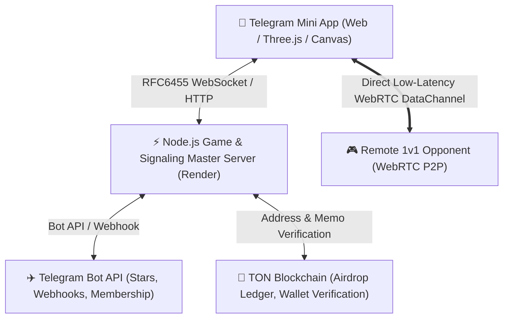

# ⚽ FOOTY vs HOOPS 🏀
> **“Vote with your money for the best sport.”**  
> An international sports arcade & Web3 PvP ecosystem built around the ultimate rivalry: **Football vs. Basketball**.

[](https://t.me/FootyHoopsGameBot)
[](https://footy-vs-hoops.onrender.com/)
[](https://x.com/footyvshoops?s=11)
[](https://t.me/FootyHoops)
[]()

---

## 🌟 Executive Summary

**FOOTY vs HOOPS** is a competitive 1v1 sports arcade game and GameFi ecosystem where two global athletic powerhouses collide:
* ⚽ **$FOOTY (Team Football)** — Led by Striker #10
* 🏀 **$HOOPS (Team Basketball)** — Led by Forward #23

Unlike conventional sports games focused on single teams or athletes, **FOOTY vs HOOPS puts two entire sporting cultures against each other**. Players choose their allegiance permanently, compete in fast-paced 1v1 arcade matches, customize their athlete with 68 collectible items across 10 detailed 3D arenas, and participate in community rivalry metrics.

For complete project documentation, tokenomics vision, and fundraising roadmap, see **[PROJECT_OVERVIEW.md](./PROJECT_OVERVIEW.md)**.

---

## 🎮 Key Product Features

| Feature | Description |
| :--- | :--- |
| **⚽ Football Mode** | Realistic 3D arcade soccer with dynamic shooting, turbo sprint, stamina physics, and sudden death overtimes. |
| **🏀 Basketball Mode** | High-energy hardwood court action with jump shots, dunks, backboard rebound physics, and clutch overtime play. |
| **⚡ 1v1 Online Multiplayer** | Real-time WebRTC P2P netcode backed by RFC6455 WebSockets and global STUN signaling for low-latency matches. |
| **🔑 Private Rooms** | 6-digit room code system allowing players to instantly challenge friends worldwide. |
| **🏟️ 10 Scenic Arenas** | Handcrafted world venues (Coastal Sunset Court, Redwood Forest, Orbital Space Colosseum, Neo Tokyo Megacity, etc.). |
| **👕 Wardrobe & Items** | 68 items: official jerseys, balls, stadium courts, celebrations, visual particle trails, and avatar frames. |
| **🎟️ Dual-Track Battle Pass** | 30-level seasonal progression with parallel Free and VIP reward tracks. |
| **⭐ Telegram Stars Integration** | Native digital purchasing with XTR Stars via official Telegram Bot API webhooks. |
| **💎 Web3 / TON Vision** | Non-custodial TON wallet linking for future ecosystem airdrop qualification. |

---

## 🏗️ Technical Architecture



### Technology Stack
* **Client Frontend:** Vanilla ES6+, WebGL/Canvas rendering, Three.js 3D physics, Telegram WebApp SDK.
* **Server Backend:** Node.js HTTP/WebSocket server, in-memory state engine with atomic persistence (`data.json`).
* **Multiplayer Netcode:** WebRTC DataChannel + RFC6455 WebSocket fallback relay.
* **Cloud Infrastructure:** Render Web Services with 24/7 keep-alive monitoring.
* **Payment Rails:** Telegram Stars (XTR) invoices, TON Connect wallet binding.

---

## 🚀 Quick Start & Verification

### Running Tests Locally
```bash
# Automated verification test suite (28/28 checks)
node tests/verify.js

# Critical gameplay regression suite (24/24 checks)
node scripts/test_gameplay_critical.js
```

### Starting the Server
```bash
# Start backend server on port 8099 (or PORT env)
node server/server.js
```

---

## 📈 Fundraising & Investment

* **Stage:** Pre-Seed Round
* **Target Raise:** **$55,000 USD**
* **Core Objectives:**
  * Core gameplay expansion & 3D character engine upgrades.
  * Dedicated low-latency multiplayer server scaling.
  * Comprehensive smart contract and payment security audits.
  * International user acquisition and Telegram GameFi marketing.

For inquiries: [footyvshoops@gmail.com](mailto:footyvshoops@gmail.com) | Official X: [@footyvshoops](https://x.com/footyvshoops?s=11)
